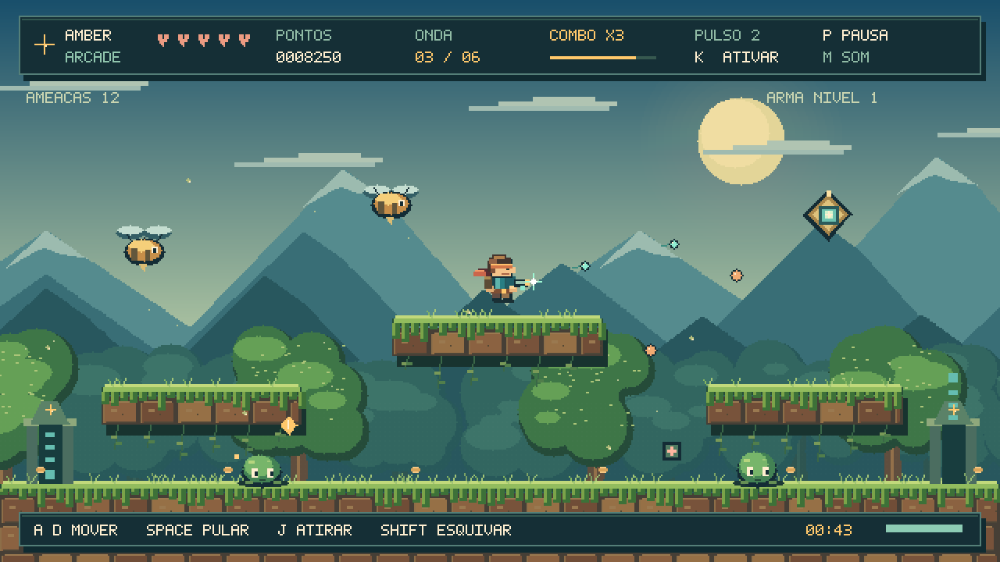

# Amber Arcade — A Arena do Bosque

Jogo arcade de sobrevivência em **C++17** para Windows. O visual mantém a pixel art, a paleta, o personagem e as camadas de cenário do Bosque de Âmbar. A jogabilidade acontece em uma arena com plataformas, tiros de energia, ondas de inimigos e melhorias entre as ondas.



**Versão 1.0:** seis ondas completas e um chefe final. Inclui código-fonte e executável Windows de 64 bits. Não exige internet, Python, SFML ou instalação de recursos gráficos para jogar.

## Começar a jogar

1. Baixe o projeto em **Code → Download ZIP** e extraia **todo o ZIP**, ou clone o repositório:

   ```powershell
   git clone https://github.com/eliasramineli-sys/AmberArcade.git
   cd AmberArcade
   ```

2. Abra **AmberArcade.exe** ou **JOGAR.bat**.
3. Pressione **Enter**, **Espaço** ou clique na janela para iniciar.

O executável incluído no repositório foi compilado para Windows; a janela, o áudio e o teclado desta versão ainda precisam ser conferidos nesse sistema. Os testes das regras, a partida automatizada e o renderizador foram executados em Linux.

| Tecla | Ação |
|---|---|
| A / D ou setas esquerda / direita | Mover |
| Espaço / W / seta para cima | Pular |
| Segurar J / Z ou botão esquerdo do mouse | Atirar continuamente |
| Shift | Esquiva rápida na direção do personagem |
| K / X | Pulso de energia |
| 1 / 2 / 3 | Escolher melhoria entre ondas |
| Enter na tela de melhorias | Escolher Poder |
| P / Esc | Pausar / continuar |
| R | Reiniciar a partida |
| M | Ativar / desativar efeitos sonoros |
| F11 | Alternar tela cheia |
| Alt + F4 | Fechar |

**Objetivo:** sobreviva às seis ondas e derrote o Guardião. Os tiros miram automaticamente no inimigo ativo mais próximo, incluindo inimigos acima das plataformas. Os projéteis de energia atravessam plataformas. Inimigos em surgimento piscam e ainda não recebem nem causam dano.

Comece com cinco pontos de vida e dois pulsos. O pulso causa dano em área e elimina projéteis próximos. A esquiva oferece invulnerabilidade curta, com recarga de 1,3 segundo. A janela pausa ao perder o foco.

## Ondas e melhorias

| Onda | Ameaças |
|---|---|
| 1 | 6 slimes terrestres |
| 2 | 8 inimigos, incluindo vespas que perseguem o jogador |
| 3 | 10 inimigos, incluindo orbes que disparam projéteis |
| 4 | 12 inimigos com mais resistência |
| 5 | 14 inimigos com mais resistência |
| 6 | Guardião e 5 inimigos de apoio |

Ao concluir cada uma das cinco primeiras ondas, escolha uma melhoria permanente até o fim da partida:

| Opção | Efeito |
|---|---|
| 1 — Poder | +1 de dano por tiro |
| 2 — Velocidade | Reduz o intervalo entre tiros em 22%, equivalente a aproximadamente 28% mais tiros por segundo; existe um limite de cadência |
| 3 — Vitalidade | +1 de vida máxima, até 10, e cura completa |

O Guardião dispara rajadas e ganha um padrão adicional quando perde metade da vida. A campanha termina em vitória ao eliminar todas as ameaças da sexta onda.

## Pontuação e itens

- Slime: 100 pontos; vespa: 150; orbe: 220; Guardião: 3.000.
- Cristal: 25 pontos. A cada quatro eliminações consecutivas, o multiplicador sobe um nível, até ×5. O combo expira após 3,2 segundos sem eliminar um inimigo e é interrompido ao receber dano.
- Ao concluir uma onda: bônus de `300 × número da onda`.
- Na vitória: mais 500 pontos por ponto de vida restante.
- A cada cinco eliminações, surge um item de cura; a cada nove, uma carga de pulso. Itens próximos são atraídos pelo jogador.
- Itens que sobraram são coletados automaticamente ao concluir a onda.

O recorde e o estado do som são salvos em `%LOCALAPPDATA%\AmberArcade\record.txt`. A partida em andamento não é salva. O arquivo é independente do recorde do Bosque de Âmbar.

## Recompilar no Windows — MSYS2 UCRT64

Requer GCC com suporte a C++17, como o instalado em `C:\msys64\ucrt64\bin\g++.exe`. Abra a pasta no VS Code e execute no PowerShell:

```powershell
powershell -NoProfile -ExecutionPolicy Bypass -File .\build.ps1
.\AmberArcade.exe
```

Também é possível dar dois cliques em **COMPILAR.bat**. O script procura o compilador no PATH e no local padrão do MSYS2; não baixa pacotes.

Para compilar e executar os testes:

```powershell
powershell -NoProfile -ExecutionPolicy Bypass -File .\build.ps1 -Test
```

## CMake / Visual Studio

Requer CMake 3.20+ e um compilador C++17. No Visual Studio, instale o componente **Desenvolvimento para desktop com C++** e abra a pasta do projeto ou execute:

```powershell
cmake -S . -B build
cmake --build build --config Release
ctest --test-dir build -C Release --output-on-failure
.\build\Release\AmberArcade.exe
```

O último caminho corresponde ao gerador Visual Studio. Com um gerador de configuração única, o executável fica diretamente em `build`.

## Estrutura do projeto

| Arquivo | Responsabilidade |
|---|---|
| `src/game.hpp` | Tipos e estado do jogo |
| `src/game.cpp` | Física, tiros, ondas, inimigos, melhorias, itens e pontuação |
| `src/render.cpp` | Pixel art, animações, fontes, interface e renderizador |
| `src/platform_windows.cpp` | Janela, teclado, mouse, áudio e recorde |
| `src/main.cpp` | Inicialização e captura sem janela |
| `tests/tests.cpp` | 37 verificações, incluindo uma partida completa automatizada |
| `docs/VALIDACAO.md` | Verificações realizadas e limites da validação |
| `docs/demo.mp4` | Oito segundos de simulação renderizada pelo próprio jogo |

Os gráficos e os efeitos sonoros são gerados pelo código. A janela usa APIs nativas do Windows. O quadro é montado fora da tela e copiado pronto para a janela, mantendo o ajuste de renderização do projeto anterior. A resolução lógica é de 640 × 360 pixels, ampliada em escala inteira com barras para preservar a proporção.

Para ajustar a dificuldade, veja `beginWave`, `spawnEnemy` e os padrões de inimigos em `Game::update`. As plataformas estão em `Game::reset`. As regras são independentes da janela do Windows.

## Testes e prévias em Linux

O modo interativo é específico para Windows. Em Linux, é possível executar os testes e renderizar imagens sem janela:

```sh
g++ -std=c++17 -O2 -Wall -Wextra -Wpedantic -Isrc tests/tests.cpp src/game.cpp src/render.cpp -o arcade_tests
./arcade_tests
g++ -std=c++17 -O2 src/main.cpp src/game.cpp src/render.cpp -o arcade_preview
./arcade_preview --screenshot frame.ppm play
./arcade_preview --demo demo_frames
```

As cenas de captura são `title`, `play`, `boss` e `upgrade`. Essas capturas montam situações representativas usando o mesmo renderizador da partida. O vídeo incluído usa uma simulação de oito segundos com comandos automatizados; não é uma gravação da interface Windows. Os PNGs foram convertidos dos quadros PPM e ampliados sem suavização.

## Limites desta versão

Um jogador, seis ondas e uma arena. Não inclui multiplayer, suporte a controle, editor de mapas ou trilha musical. A execução interativa deste novo executável no Windows ainda precisa de validação. O workflow de GitHub Actions compila e executa os testes em Linux e Windows a cada push ou pull request. Consulte o resultado da execução na aba Actions do repositório.

A licença de distribuição do código fica a definir pelo autor. A arte e os efeitos foram feitos para estes projetos; não dependem de sprites comerciais.
